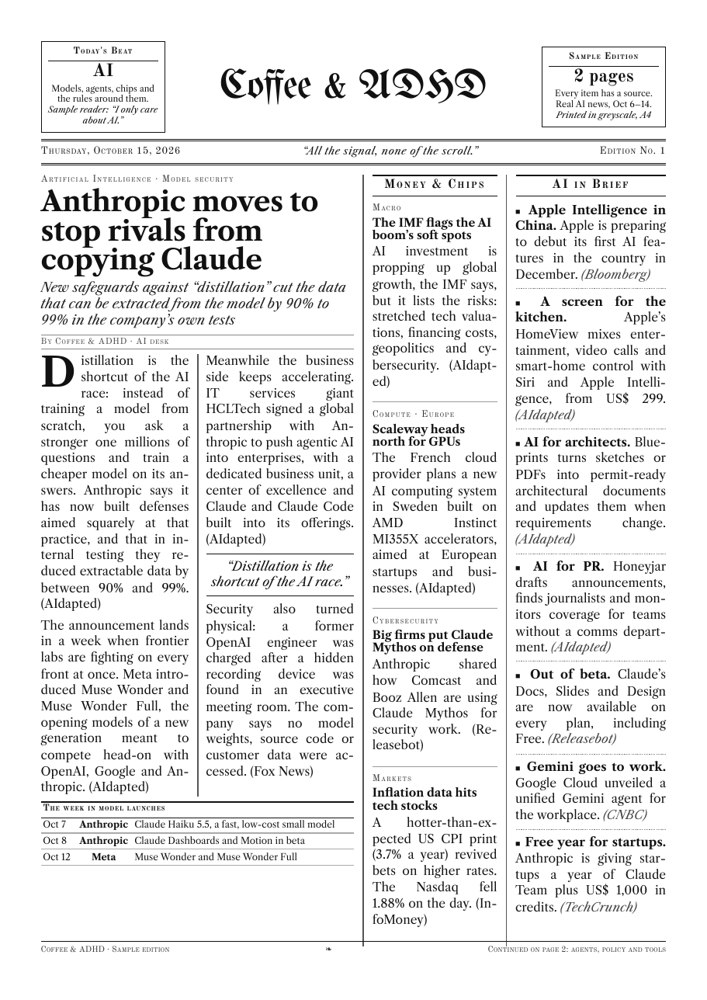
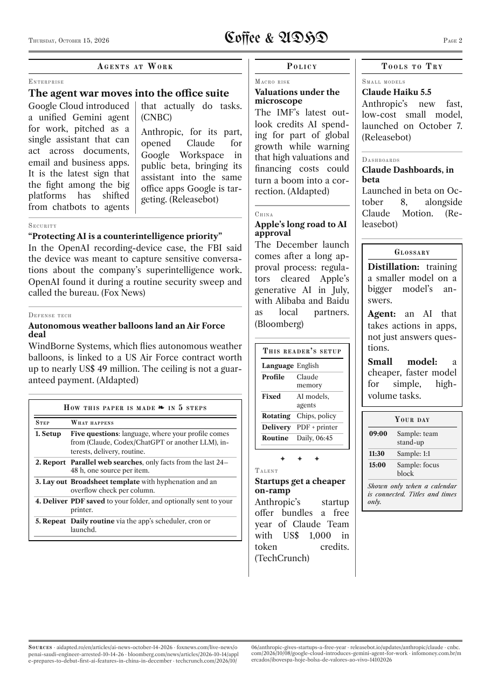

# skills

[](https://skills.sh/raphaelcunha/skills)

**English** · [Português (Brasil)](README.pt-BR.md)

Skills for Claude and other agents that support the [Agent Skills](https://skills.sh) format.

## Install

```bash
npx skills add raphaelcunha/skills
```

To install a single skill:

```bash
npx skills add raphaelcunha/skills --skill coffee-and-adhd
```

## Skills

### `coffee-and-adhd` — Coffee & ADHD

A daily newspaper made just for you. It comes out as an A4 PDF of up to 2 pages, in black and white, with a print-optimized layout (10 pt serif body, a quick-read summary at the top, one illustration per edition), and it can go straight to your printer.

<p align="center">
  
  
</p>

<p align="center"><sub>Sample edition for a reader who only follows AI, built from real news published Oct 6–14, 2026. No personal data. <a href="docs/sample-edition.pdf">Download the PDF</a>.</sub></p>

- **Quick setup:** on the first run the skill asks about 5 questions (plus one about connected apps), one at a time, each with a default you can simply accept:
  1. Which language? It suggests Brazilian Portuguese (PT-BR), English or Spanish.
  2. Where should your profile come from? Claude's memory, Codex/ChatGPT's or another LLM's memory (you paste what it knows about you), or answers on the spot.
  3. Your interests and city.
  4. The newspaper's name, which defaults to "Coffee & ADHD" ("Café & TDAH" in Portuguese or Spanish). Also: where to save the PDF, and whether to print it at the end and on which printer.
  5. Whether to set up a daily routine: an app scheduled task, cron/launchd on your computer, or on demand only.
  6. Which connected apps it may read. It lists the connectors and plugins it finds (Gmail/Outlook, Slack/Teams, Google Calendar, Linear/Jira/GitHub, Granola/Fireflies, Notion/Drive) and suggests up to 3 missing ones that would help you.

  Your answers are saved to `coffee-and-adhd.json`, so the routine works with any agent.
- **Reporting:** only news from the last 24–48 hours, with a source on every item. If the skill can't find a fact, it says so instead of making one up.
- **What's in an edition:** local weather, a city page with cultural events and, if you connected apps, a "Your day" box: today's meetings, tasks due, PRs waiting for your review, to-dos from yesterday's meetings, and how many emails and mentions came in. Newsletters in your inbox can also suggest stories, always cited from the public source.
- **Privacy:** connected apps are read-only (the skill never sends, replies or marks anything as read), and only times, titles, ids and counts go on paper, never message text or other people's names. Mail and chat are off unless you turn them on.
- **Layout:** an HTML template with embedded open-source fonts (Alfa Slab One, Rokkitt, Bitter), a small library of black-and-white illustrations, and `scripts/render.py`. The script hyphenates the text (pt-BR, en, es and more), renders the PDF with Playwright/Chromium, and warns if a column overflows or the paper goes past 2 pages.
- **Printing (optional):** uses `lp` on your computer (macOS/Linux), in A4 and greyscale.

Example requests:

> "set up my Coffee & ADHD"
> "make today's edition of my newspaper"
> "monta meu jornal de hoje"

**Requirements:** Python 3, `playwright` (with Chromium), `pyphen`, `beautifulsoup4`, and `pdfinfo`/`pdftoppm` (poppler). To print, the agent must be able to run commands on the computer the printer is attached to.

## License

Code and instructions are MIT-licensed (see `LICENSE`).

The fonts embedded in `skills/coffee-and-adhd/assets/template.html` are distributed under the [SIL Open Font License 1.1](skills/coffee-and-adhd/assets/FONTS-LICENSE.txt):

- Alfa Slab One, by JM Solé
- Rokkitt, by Vernon Adams
- Bitter, by Huerta Tipográfica

The font files come from the [Fontsource](https://fontsource.org) packages.
